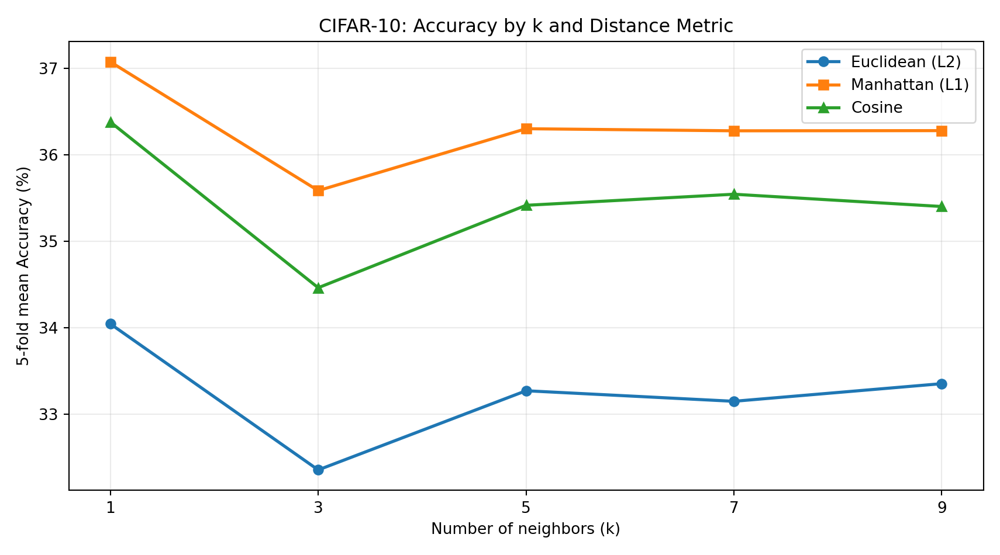

# CIFAR-10 KNN Classification (GPU)

CIFAR-10 전체 데이터를 사용하여 **K-Nearest Neighbors (KNN)** 분류를 수행하고, 서로 다른 `k` 값과 거리 측정 방법을 **Stratified 5-fold cross-validation**으로 비교한 Python 프로젝트입니다. 한국어 주석을 포함했습니다.

## 실험 구성

- **데이터:** CIFAR-10 학습 50,000장 / 독립 테스트 10,000장 (32×32 RGB, 3,072차원 픽셀)
- **5-fold:** 매 Fold에서 학습 40,000장, 검증 10,000장
- **이웃 수:** `k = [1, 3, 5, 7, 9]`
- **거리:** Euclidean (L2), Manhattan (L1), Cosine
- **평가:** Accuracy, Macro Precision, Macro Recall, Macro F1-score
- **가속:** NVIDIA GPU / PyTorch CUDA

## 실행 결과

| Metric | Value |
|---|---:|
| Best cross-validation configuration | **Manhattan, k=1** |
| 5-fold mean Accuracy | **37.08%** |
| 5-fold mean Macro F1 | **36.90%** |
| Final test Accuracy (10,000 images) | **38.59%** |
| Final test Macro Precision | **43.33%** |
| Final test Macro Recall | **38.59%** |
| Final test Macro F1 | **38.62%** |



이 그래프의 각 점은 **5개 Fold의 평균 Accuracy**입니다. 최종 테스트 결과는 교차검증에서 최적 조합을 선택한 다음, 별도 테스트 10,000장으로 평가한 값입니다.

## 파일 구성

```text
cifar10-knn-gpu/
├── knn_cifar10_gpu.py            # GPU KNN, 5-fold, 평가지표, CSV 저장
├── plot_confusion_only.py        # 최종 테스트 혼동행렬 생성 (선택)
├── requirements.txt              # numpy, scikit-learn, matplotlib
├── figures/
│   ├── accuracy_by_k.png         # k x 거리별 5-fold 평균 Accuracy
│   └── cv_f1_comparison.png      # F1 비교 그래프
└── results_full_gpu/
    ├── cv_fold별_결과.csv         # 총 75개 Fold별 결과
    ├── cv_평균_표준편차.csv       # 15개 조합 평균/표준편차
    ├── test_최종결과.csv         # 별도 테스트 데이터 평가
    └── 설정.json                 # 재현 실험 설정
```

## 실행 방법 (Windows / VS Code)

1. CIFAR-10 Python 버전의 `cifar-10-python.tar.gz`를 [공식 CIFAR-10 페이지](https://www.cs.toronto.edu/~kriz/cifar.html)에서 받아, `knn_cifar10_gpu.py`와 **동일한 폴더**에 둡니다. 압축을 해제할 필요는 없습니다.
2. NVIDIA 드라이버가 준비되어 있는지 `nvidia-smi`로 확인합니다.
3. 아래 명령어로 Python 의존성을 설치합니다. **PyTorch는 반드시 자신의 CUDA/드라이버 환경에 맞는 버전**을 [PyTorch 공식 설치 페이지](https://pytorch.org/get-started/locally/)에서 선택해 설치해야 합니다.

```powershell
py -m pip install -r requirements.txt
py -m pip install torch --index-url https://download.pytorch.org/whl/cu128
```

> 위 PyTorch 명령어는 **CUDA 12.8을 지원하는 드라이버 환경의 예시**입니다. 자신의 GPU 환경에 맞지 않으면 공식 페이지에서 다른 명령어를 선택하세요.

4. GPU 인식과 코드 기능을 검사하고 실험을 실행합니다.

```powershell
py knn_cifar10_gpu.py --gpu-check
py knn_cifar10_gpu.py --self-test
py knn_cifar10_gpu.py
```

5. 혼동행렬이 필요하면 최종 테스트 예측값으로 생성합니다.

```powershell
py plot_confusion_only.py
```

`results_full_gpu/test_예측상세.csv`가 존재한다면 이를 재사용하고, 없다면 최적 조합으로 최종 테스트 예측을 새로 계산합니다. **현재 저장소에는 실제 이미지별 예측 CSV나 혼동행렬이 포함되어 있지 않습니다.** 기존 실험 결과를 바탕으로 임의의 행렬을 생성하지 않았습니다.

## 참고

- CIFAR-10 데이터는 저장소에 포함하지 않았습니다.
- GPU VRAM이 부족하면 코드 상단의 `TRAIN_CHUNK`를 줄여 실행할 수 있습니다.
- 코드의 원본 이미지, 결과 파일, 그래프는 별개의 데이터입니다. 전체 데이터 실험 결과는 `results_full_gpu/*.csv`에서 확인할 수 있습니다.
